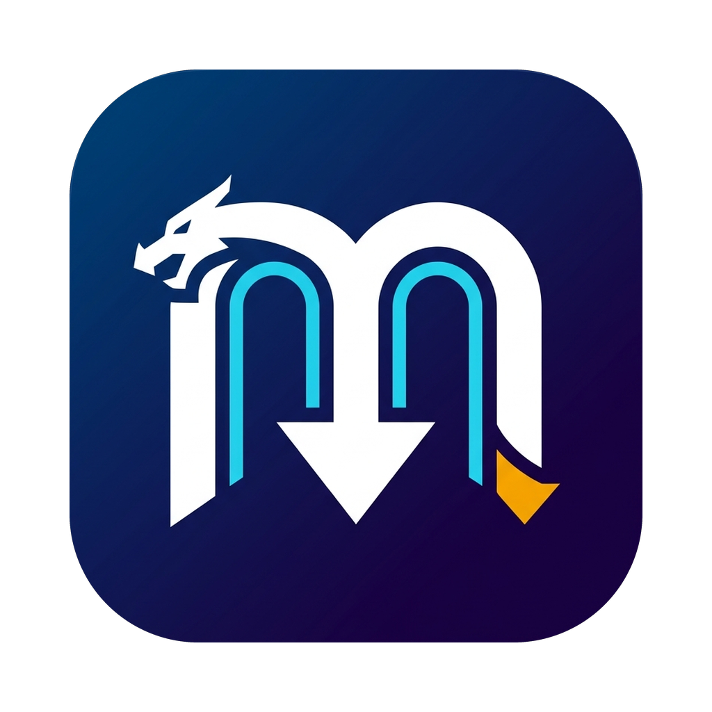
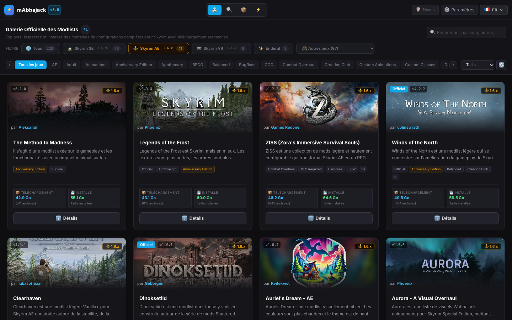
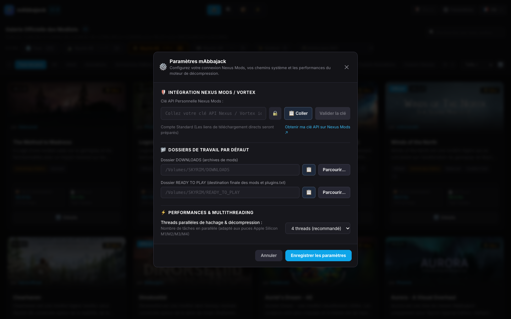
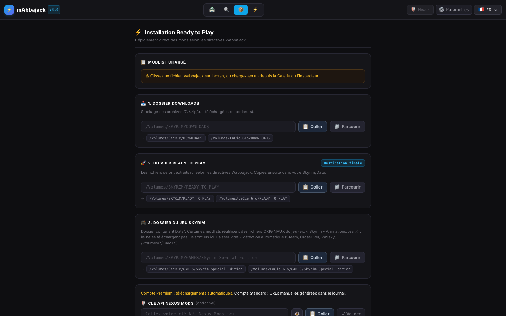
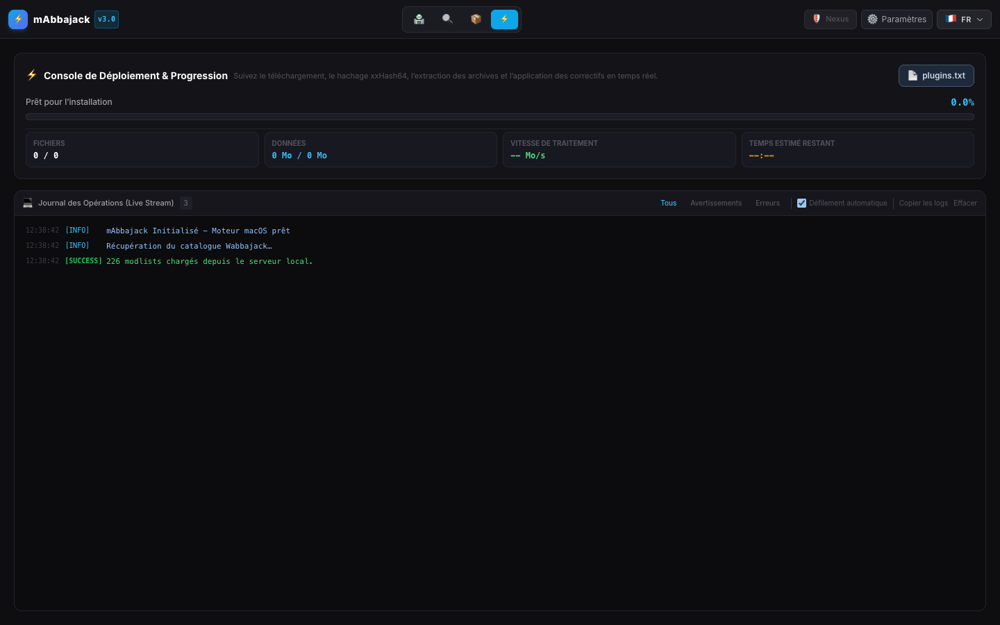
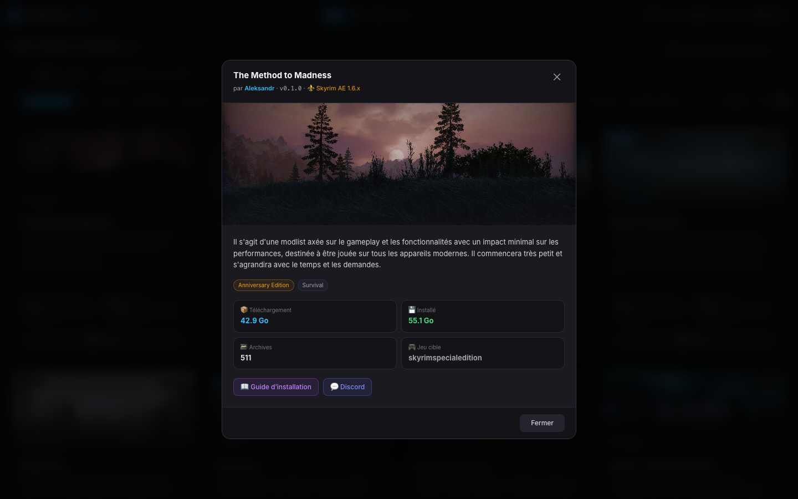

# mABBAJACK — Wabbajack modlist installer for macOS

> Page Nexus prête à coller (BBCode) : `docs/release/NEXUS_PAGE.bbcode`. Paquet : `scripts/package_release.sh`.

**Install Wabbajack modlists natively on your Mac — no Windows VM required.**

*(FR : voir la section française en bas de page.)*

## What is it?
Wabbajack is Windows-only. **mABBAJACK** is an unofficial macOS port of the modlist installation process: browse the official gallery, pick a list (Skyrim SE/AE/VR, Enderal, 97+ other-game lists), and install it with one click.

## Features
- Official gallery (~226 modlists), filters SE / AE / VR / Enderal / Other games, tags, search, sort by size/name/date.
- `.wabbajack` inspector (drag & drop).
- Complete install pipeline: FromArchive, InlineFile, PatchedFromArchive (OctoDiff), CreateBSA (native writer, uncompressed), Stock Game / original game files.
- Automatic Nexus downloads (Premium) or manual links (free account).
- Vortex-style download folder (`<DOWNLOADS>/skyrimse`).
- Game auto-detection: Steam, CrossOver, Whisky, `/Volumes/*/GAMES`.
- Live operation log with filters, saved to `~/Library/Logs/mABBAJACK/`; `plugins.txt` and `loadorder.txt` generated.
- UI in English, French, Spanish, Italian.
- Standalone `.app`: native window, Node, 7zz and unar bundled.

| Settings | Install | Console |
|---|---|---|
|  |  |  |

## Requirements (Mac)
- **macOS 13.5 or later on Apple Silicon** (M1 or later, arm64 only).
- **Nothing else to install** for the standalone app (no Node, 7zz or unar needed).
- A **legitimate copy of the game** installed on the Mac (Steam, CrossOver or Whisky).
- A **Nexus Mods API key**; **Premium account** recommended (free accounts get manual download links).
- **Disk space**: tens of GB for DOWNLOADS + READY TO PLAY (modlists are often 40–65 GB each).
- Internet connection.
- Running the resulting game requires a Windows compatibility layer (CrossOver, Whisky…).
- Building from source only: python3, npm, Xcode (7zz and unar are compiled by `scripts/build_portable_tools.sh`).

## Installation
1. Download and unzip `mABBAJACK.app`, place it in Applications.
2. The app is **not notarized**: open it once, then **System Settings → Privacy & Security → Open Anyway**, or run `xattr -dr com.apple.quarantine /Applications/mABBAJACK.app`.
3. Open **Settings**: Nexus API key, DOWNLOADS and READY TO PLAY folders.
4. Pick a modlist, check the game folder in the **Install** tab, start.

## Known limitations
- Unofficial, not affiliated with Wabbajack.
- Recreated BSAs are uncompressed.
- Stock Game masters may differ from the manifest (kept with a warning).
- Wabbajack MO2 caches (shadercache, nemesis_engine…) are intentionally skipped.
- Very large installs can take hours.

## Credits
Wabbajack team and modlist authors. Local server on port 38300; your API key is never logged.

---

# 🇫🇷 Version française
**mABBAJACK** installe les modlists Wabbajack nativement sur Mac, sans VM Windows. Galerie officielle, inspecteur `.wabbajack`, téléchargements Nexus automatiques (Premium), détection du jeu, journal en direct, interface FR/EN/ES/IT.

**Pré-requis Mac** : macOS 13.5+ sur Apple Silicon, copie légale du jeu (Steam/CrossOver/Whisky), clé API Nexus (Premium recommandé), plusieurs dizaines de Go libres, couche de compatibilité Windows pour lancer le jeu. Au premier lancement (app non notariée) : Réglages Système → Confidentialité et sécurité → « Ouvrir quand même », ou `xattr -dr com.apple.quarantine /Applications/mABBAJACK.app`.

**Installation** : ouvrez `mABBAJACK.app` → Paramètres (clé Nexus, dossiers) → choisissez une modlist → onglet Installation → lancez.
